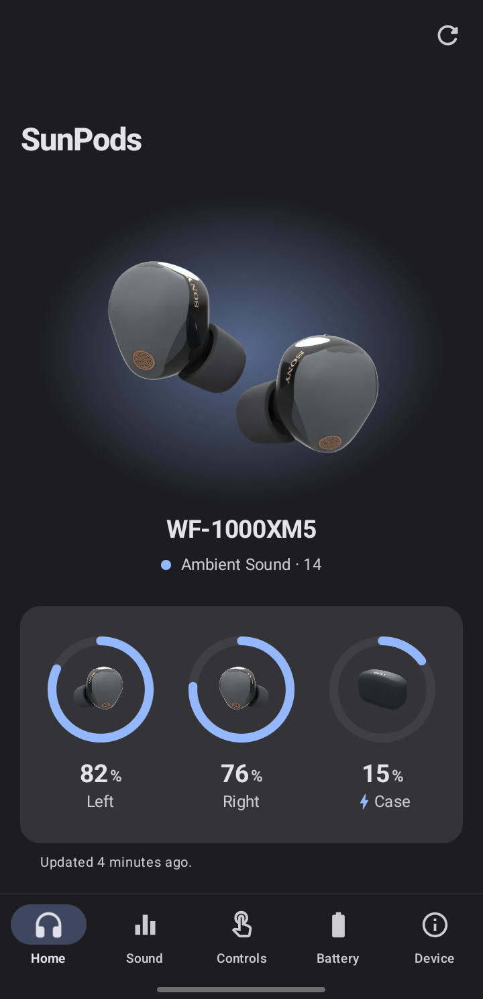
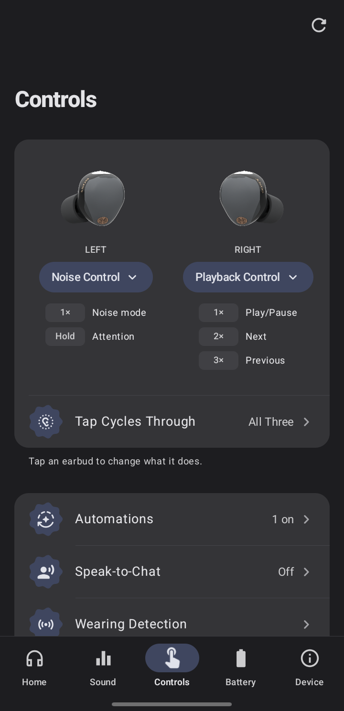
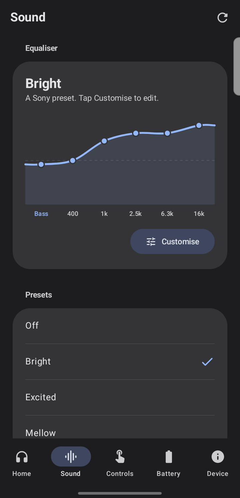

# SunPods

An unofficial, free and open source companion app for the Sony WF-1000XM5 and WF-C710N on Android.
Not made by or affiliated with Sony.

  
  &nbsp;
  
  &nbsp;
  

## Download

Get the APK from the [latest release](https://github.com/Sisyphusean/SunPods/releases/latest).
Android 10 or later.

Pair the earbuds in Android's Bluetooth settings first, then open SunPods and follow the setup.
Close Sony Sound Connect while you use SunPods: the earbuds only talk to one control app at a time.

SunPods tells you when a new version is out. To have updates installed for you, use
[Obtainium](https://obtainium.imranr.dev/): in Obtainium tap **Add App**, paste
`https://github.com/Sisyphusean/SunPods` and tap **Add**. On a phone with Obtainium installed, this
button does the same:

## What it does

- **Battery** for each earbud and the case, in the app, a notification, home screen widgets and a
  Quick Settings tile, with an estimate of the listening time left
- **Noise control**: noise cancelling, ambient sound with level and focus on voice, or off
- **Equaliser**: Sony's presets, your own five-band curve and Clear Bass
- **LE Audio**: switch between Classic and LE Audio from the app, for clearer calls
- **Touch controls**: pick what each earbud does from the options your earbuds offer, with the
  gestures spelled out
- **The earbuds' own settings**: Speak-to-Chat, pause when you take one out, DSEE Extreme,
  connection quality, voice guidance, automatic power off
- **Devices**: see, connect and switch between the devices your earbuds remember
- **Call mic test**, so you can hear what people on calls hear
- **Automations** for calls and walks, **battery health** over time, and where your earbuds were
  **last seen**

Everything stays on your phone. The only thing SunPods does online is check GitHub once a day for a
new version, and you can turn that off.

## Supported earbuds

| Earbuds | Status | Notes |
| --- | --- | --- |
| **WF-1000XM5** | ✅ Works | Classic and LE Audio, firmware 6.1.0 tested |
| **WF-C710N** | 🧪 Testing | Built from Sony's own app and tested on simulated earbuds; [needs a tester](https://github.com/Sisyphusean/SunPods/issues/2) |
| WF-1000XM4 | ⏳ Not yet | |
| WH-1000XM5, WH-1000XM6 | ⏳ Not yet | |
| LinkBuds, LinkBuds S, Fit, Open | ⏳ Not yet | |
| Earbuds from other brands | ❌ Not supported | Sony only |

SunPods grows one model at a time. Sony's earbuds share most of their commands, but each model has
its own quirks, so a model is only marked as working once someone has tested it. SunPods asks the
earbuds what they support, the way Sony's app does, and shows only that. Send Diagnostics (Device >
Help and About) includes the earbuds' replies, with nothing personal in them, so a tester's report
is enough to fix a model. Own one of the models
above and want to help? [Tell us](https://github.com/Sisyphusean/SunPods/issues/new?template=earbuds_request.yml).

## Switching between Classic and LE Audio

The switch means your phone has to pair with the earbuds again, which Android only lets apps do with
help. SunPods uses [Shizuku](https://shizuku.rikka.app/) for that, so it happens by itself. Without
Shizuku, SunPods doesn't switch and tells you why.

- LE Audio needs Android 13 or later and a phone that supports it. SunPods checks before switching.
- Shizuku stops when your phone restarts, and some phones close it in the background. Set Shizuku's
  battery use to **Unrestricted**.
- On LE Audio, Connect to Two Devices, the device list and DSEE Extreme are off. Switch back to
  Classic to use them.

## More

- [Changelog](CHANGELOG.md)
- [Building, releasing and how it works](docs/development.md)
- [Security](SECURITY.md)

## Credits

The protocol work behind SunPods was checked against [Gadgetbridge](https://codeberg.org/Freeyourgadget/Gadgetbridge)
(AGPL-3.0-or-later) and SonyBridge (MIT); no code from either is included. LE Audio switching relies
on [Shizuku](https://github.com/RikkaApps/Shizuku). The earbud and case renders were modelled for this
project.

GPL-3.0 licensed; see [LICENSE](LICENSE). Sony, WF-1000XM5 and Sony's other product names are
trademarks of Sony Group Corporation, used here only to say what this software works with.
